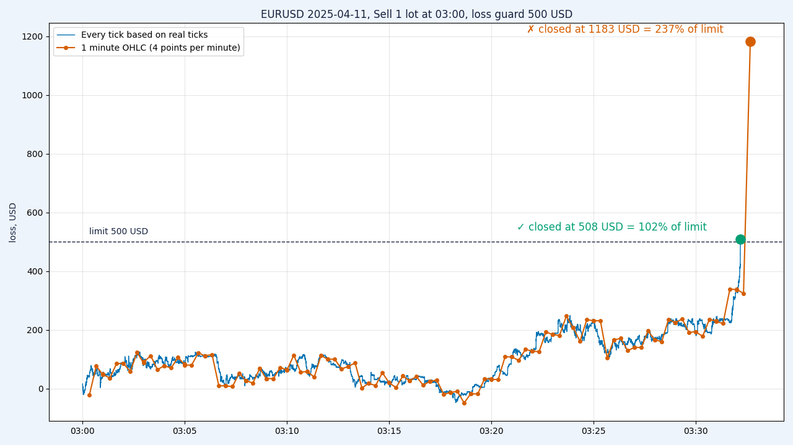

# 05 — "1 minute OHLC" vs real ticks: a loss guard in the Strategy Tester

Documentation: [Tick Generation Modes](https://www.mql5.com/en/docs/runtime/testing#ticks), [Using real ticks during a test](https://www.mql5.com/en/docs/runtime/testing) ·
article: [The Algorithm of Ticks' Generation within the Strategy Tester](https://www.mql5.com/en/articles/75)

**Problem.** A loss guard must close the trade at −$500. In the tester it closed at −$1,183.

**Why.** In **1 minute OHLC** mode the tester builds only 4 ticks per minute bar: Open, Low, High, Close (documentation: no intermediate ticks are generated).
A guard that checks equity in `OnTick` sees the loss only on those 4 ticks. In a fast minute the loss crosses the limit between two ticks, and the guard fires on the bar's High or Low.

```mql5
void OnTick()
  {
   double loss = m_start - AccountInfoDouble(ACCOUNT_EQUITY);
   if(loss >= InpLimit)               // checked only when a tick arrives
      m_trade.PositionClose(Symbol());
  }
```

**Our result** (FxPro-MT5, MetaTrader 5 build 6230, EURUSD, 2025-04-11, Sell 1 lot at 03:00 server time, limit $500, deposit $10,000):

| Mode | OnTick calls per day | Ticks in the busiest minute | Guard fired | Closed at |
|---|---|---|---|---|
| 1 minute OHLC | 5,754 | 4 | 03:32:40, bid 1.13739 (the bar's High) | **−$1,183 = 237% of the limit** ✗ |
| Every tick based on real ticks | 931,554 | 1,141 | 03:32:10, bid 1.13062 | **−$508 = 102% of the limit** ✓ |

At 03:32 (server time) EURUSD moved 86 points in one minute: 1.12894 → 1.13739.

**The rule.**
- Entries on closed bars: 1 minute OHLC is fine (and fast).
- Account protection (daily loss limit, equity stop, trailing): test on **Every tick based on real ticks**.
- Check **History Quality** in the report: where the broker has no ticks, the tester generates them (documentation).
- Even real ticks give 102%, not 100%: the guard reacts to the next tick. Live trading adds slippage.

## How to reproduce

> ⚠️ **Your numbers may differ.** They depend on the broker's tick history, server time zone, spread and contract size.
> On another server you will get other values, but the gap between the two modes stays: OHLC fires on the High/Low of the fast bar, real ticks fire near the limit.

1. **Copy and compile.** `mql5/GuardLab.mq5` → `MQL5/Experts/Lessons/GuardLab/GuardLab.mq5`, compile in MetaEditor (0 errors, 0 warnings).
2. **Find the fast minute on your server.** Open EURUSD M1 for 2025-04-11 and find the 86-point candle (00:32 UTC; 03:32 on a GMT+3 server such as FxPro).
   Set `InpHour` to the server hour **about 30 minutes before** that candle (for a GMT+3 server: 3; for GMT+2: 2; for GMT: 0).
3. **Run the tester twice** with the same settings, changing only the modelling mode:

   | Setting | Value |
   |---|---|
   | Expert | Lessons\GuardLab\GuardLab |
   | Symbol / period | EURUSD, M1 |
   | Dates | 2025.04.11 – 2025.04.12 |
   | Deposit / leverage | 10000 USD, 1:100 |
   | Inputs | Sell, 1.0 lot, `InpHour` from step 2, limit 500, log 60 min |
   | Run 1 | Modelling: **1 minute OHLC** |
   | Run 2 | Modelling: **Every tick based on real ticks** |

   Or from the command line with the terminal **closed** (it starts, tests and shuts down):
   `terminal64.exe /config:<full path>\tester_ohlc.ini`, then the same with `tester_ticks.ini`.
   The ini files expect `MQL5/Experts/Lessons/GuardLab/GuardLab.ex5`; if your server is not GMT+3, change `InpHour` in `[TesterInputs]`.
   The first real-tick run downloads tick history and takes longer.
4. **Read the Journal** (Strategy Tester → Journal). Each run prints a summary:
   ```
   === GuardLab | EURUSD | mode looks like: ohlc ===
   OnTick calls: 5754, most ticks in one minute: 4
   Entry: 2025.04.11 03:00:00, limit: 500.00
   Guard fired at 2025.04.11 03:32:40, bid 1.13739, loss 1183.00 = 237% of the limit
   Closed with 1183.00 = 237% of the limit (worst loss seen: 1183.00)
   Tick log: 130 rows -> Common\Files\GuardLab_EURUSD_ohlc.csv
   ```
   What to check: in OHLC the busiest minute has **4** ticks and the guard fires on the High/Low of the fast bar (well above 100%);
   on real ticks there are hundreds of ticks per minute and the result is close to **100%**.
   `mode looks like` is a guess from the ticks per minute: "Every tick" (generated) also shows `ticks`.
5. **Optional chart.** `python python/plot_guard.py` (needs `pip install pandas matplotlib`) reads both CSV files from `Common\Files`
   and saves `images/guard_compare.png`.



Video: [BARABASHKA (EN)](https://youtu.be/2bfYMYul1Z4) · [БАРАБАШКА (UA)](https://youtu.be/fA6RgbopOhU)

---

## Українською

**Проблема.** Сторож збитку мав закрити угоду на −500 $. У тестері закрив на −1 183 $.

**Чому.** У режимі **1 minute OHLC** тестер будує лише 4 тики на хвилинний бар: Open, Low, High, Close.
Сторож у `OnTick` бачить збиток тільки на цих тиках. У швидку хвилину збиток проходить ліміт між двома тиками, і сторож спрацьовує на High або Low бару.

**Наш результат** (FxPro-MT5, EURUSD, 11.04.2025, Sell 1 лот о 03:00 за сервером, ліміт 500 $): OHLC — **−1 183 $ = 237 %** ✗, реальні тики — **−508 $ = 102 %** ✓.

**Правило.** Входи по закритих барах можна тестувати на OHLC. Захист рахунку (денний ліміт, стоп за еквіті, трейлінг) — тільки на реальних тиках.
Перевіряй History Quality у звіті: де в брокера немає тиків, тестер генерує їх сам.

**Як відтворити.**

> ⚠️ **Ваші цифри можуть відрізнятися.** Вони залежать від тикової історії брокера, часового поясу сервера, спреду й розміру контракту.
> На іншому сервері числа будуть інші, але різниця між режимами лишиться: OHLC спрацьовує на High/Low швидкого бару, реальні тики — біля ліміту.

1. `mql5/GuardLab.mq5` → `MQL5/Experts/Lessons/GuardLab/`, скомпілювати (0 помилок, 0 попереджень).
2. На EURUSD M1 за 11.04.2025 знайти свічку на 86 пунктів (00:32 UTC; 03:32 на сервері GMT+3, як FxPro). `InpHour` — година сервера приблизно за 30 хв до неї (GMT+3 → 3, GMT+2 → 2, GMT → 0).
3. Два прогони з однаковими налаштуваннями (EURUSD M1, 2025.04.11–2025.04.12, 10000 USD, 1:100), змінюється лише режим: **1 minute OHLC** і **Every tick based on real ticks**.
   Або з командного рядка при **закритому** терміналі: `terminal64.exe /config:<повний шлях>\tester_ohlc.ini`, потім `tester_ticks.ini` (якщо сервер не GMT+3 — змінити `InpHour` у `[TesterInputs]`).
4. У журналі тестера — підсумок кожного прогону. В OHLC найбільше тиків за хвилину — **4**, сторож спрацьовує значно вище 100 %; на реальних тиках — сотні тиків за хвилину і результат близько **100 %**.
5. Графік (необов'язково): `python python/plot_guard.py` (`pip install pandas matplotlib`).

Відео: [БАРАБАШКА (UA)](https://youtu.be/fA6RgbopOhU) · [BARABASHKA (EN)](https://youtu.be/2bfYMYul1Z4)
